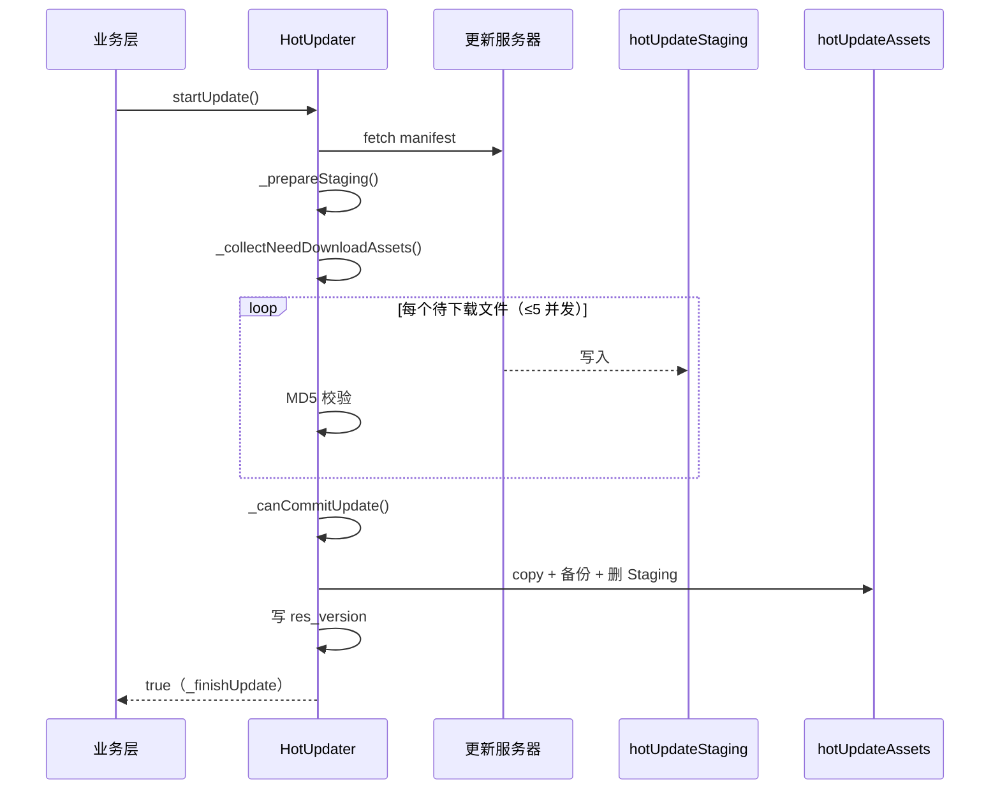
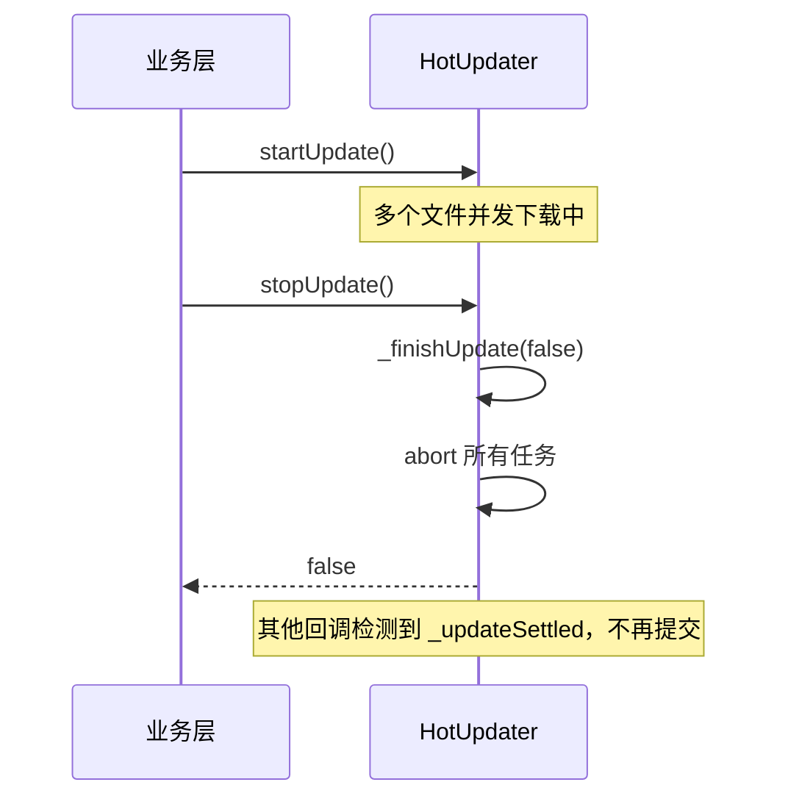

# 热更新逻辑说明

> 源码：`assets/scripts/modules/HotUpdateMgr.ts`  
> 平台：**Cocos Creator 3.8.8 Native（iOS / Android）**  
> 接入：EGF 模块 `m.hotUpdateMgr`

---

## 目录

1. [概述](#1-概述)
2. [架构与模块](#2-架构与模块)
3. [目录与持久化](#3-目录与持久化)
4. [Bundle 类型与 Manifest](#4-bundle-类型与-manifest)
5. [完整更新流程](#5-完整更新流程)
6. [Staging 暂存机制](#6-staging-暂存机制)
7. [两种下载模式](#7-两种下载模式)
8. [安全提交机制](#8-安全提交机制)
9. [并发控制与生命周期](#9-并发控制与生命周期)
10. [重试与失败策略](#10-重试与失败策略)
11. [断点续传](#11-断点续传)
12. [API 参考](#12-api-参考)
13. [服务端目录规范](#13-服务端目录规范)
14. [Native 侧要求](#14-native-侧要求)
15. [时序图](#15-时序图)
16. [FAQ](#16-faq)
17. [编辑器热更新面板插件](#17-编辑器热更新面板插件)

---

## 1. 概述

热更新采用 **Manifest + 增量 / Zip 全量下载** 方案。CDN 上 manifest、Zip、资源文件分目录存放，客户端按 `_getManifestUrl()` 拉取清单后下载。

| 目标 | 实现方式 |
|------|----------|
| 资源完整性 | 每个文件 MD5 校验 |
| 原子更新 | 先写 Staging，全部就绪后 copy 到正式目录 |
| 中断可恢复 | Staging 保留 + `pending_version` 标记 |
| 失败可控 | 重试上限 + `_updateSettled` 防重复提交 |
| Promote 可回滚 | copy 成功后再删 Staging，失败恢复正式目录 |
| 并发效率 | 增量模式最多 5 路并发下载 |

### 关键常量

| 常量 | 值 | 说明 |
|------|-----|------|
| `MaxProcessingTasks` | 5 | 增量下载最大并发数 |
| `MaxManifestRetryCount` | 3 | manifest 拉取最大重试 |
| `MaxDownloadRetryPerFile` | 3 | 单文件下载 / MD5 失败最大重试 |
| `UnzipTimeoutMs` | 300000（5 分钟） | Zip 解压超时 |
| `HOT_UPDATE_ROOT` | `hotUpdateAssets/` | 正式热更目录（本地） |
| `HOT_UPDATE_STAGING_ROOT` | `hotUpdateStaging/` | 暂存目录（本地） |
| `HOT_UPDATE_MANIFEST_DIR` | `manifest/` | 各 Bundle manifest 目录（CDN） |
| `HOT_UPDATE_ZIPS_DIR` | `zips/` | Zip 全量包目录（CDN） |
| `INCREMENTAL_ONLY_BUNDLES` | `engine` / `main` / `internal` | 始终走增量、不走 Zip 全量 |

---

## 2. 架构与模块

```
HotUpdateMgr（EGF 模块，key = "hotUpdateMgr"）
│
├── createHotUpdater(bundle, url, version)
│     └── 若已有同名校实例，先 destroyHotUpdater() 再创建
├── getHotUpdater(bundle) → HotUpdater | null
└── destroyHotUpdater(bundle)
      └── 从 Map 移除 + HotUpdater.destroy()

HotUpdater（每个 Bundle 一个实例，内部类）
│
├── checkUpdate()         → boolean            是否需要更新
├── onUpdateProgress(cb)  监听进度（0 ~ 1，可多次注册覆盖）
├── startUpdate()         → Promise<boolean>   执行更新
├── stopUpdate()          中止更新（Promise 立即 false）
└── destroy()             销毁实例（内部调用 stopUpdate）
```

### 项目接入

```typescript
// ModuleManger.ts 中注册
app.loadModule(new HotUpdateMgr(), "hotUpdateMgr");

// 业务层调用
import { m } from "./modules/ModuleManger";

const updater = m.hotUpdateMgr.createHotUpdater(
    "lobby",
    "https://cdn.example.com/hot",
    "1.2.0"
);

// 进度回调与创建分离，需在 startUpdate 前注册
updater.onUpdateProgress((percent) => {
    console.log(`进度: ${(percent * 100).toFixed(1)}%`);
});
```

### 内部状态

| 字段 | 作用 |
|------|------|
| `_isUpdating` | 防止同一实例并发 `startUpdate()` |
| `_stopped` | `stopUpdate()` 后置 true，阻止后续重试与提交 |
| `_updateSettled` | 本次更新 Promise 是否已结束，防止重复 resolve / 重复提交 |
| `_activeResolve` | 当前下载 Promise 的 resolve，供 `stopUpdate()` 立即结束 |
| `_taskRetryMap` | 记录每个下载任务的重试次数 |
| `_onProgress` | 由 `onUpdateProgress()` 注册，下载过程中回调 |
| `_remoteProjectManifest` | 每次 `startUpdate()` 重新拉取 |

---

## 3. 目录与持久化

### 3.1 CDN 目录（服务端）

以 `updateUrl = https://cdn.example.com/hot`、`version = 1.2.0` 为例：

```
https://cdn.example.com/hot/
├── version.json                      ← 当前生效的资源版本（与版本号目录同级）
└── 1.2.0/
    ├── manifest/
    │   ├── engine_version.json           ← 引擎资源 manifest
    │   ├── main_version.json             ← assets/main manifest
    │   ├── internal_version.json         ← assets/internal manifest
    │   └── lobby_version.json            ← 普通 Bundle manifest
    ├── zips/
    │   ├── lobby.zip                     ← 首次全量 Zip（仅普通 Bundle）
    │   └── zips.json                     ← 各 Zip 的 MD5 索引（编辑器上传用）
    ├── application.js                    ← engine 增量资源（示例）
    ├── main.js
    ├── jsb-adapter/ ...
    ├── src/ ...
    └── assets/
        ├── main/ ...
        ├── internal/ ...
        └── lobby/
            └── index.js
```

**version.json**（与 `{version}/` 目录同级）：

```json
{ "version": "20260613234849" }
```

| 资源类型 | CDN 路径 | 说明 |
|----------|----------|------|
| 当前生效版本 | `{updateUrl}/version.json` | 客户端 / 编辑器上传时读取 |
| 全部 manifest | `{version}/manifest/{bundleName}_version.json` | 统一放在 `manifest/` |
| Zip 全量包 | `{version}/zips/{bundleName}.zip` | 仅普通 Bundle 首次无 `res_version` 时使用 |
| Zip MD5 索引 | `{version}/zips/zips.json` | 编辑器差异上传时比对 Zip MD5 |
| engine 增量文件 | `{version}/{manifest.assets 的 key}` | 如 `application.js`、`src/chunks/xxx.js` |
| main / internal / 其他 Bundle | `{version}/{manifest.assets 的 key}` | 如 `assets/main/index.js` |

**增量下载 URL：** `{updateUrl}/{version}/{path}?md5={md5}`

### 3.2 本地磁盘目录

可写根路径：`native.fileUtils.getWritablePath()`（下文记为 `{WritablePath}/`）

```
{WritablePath}/
├── hotUpdateAssets/                          ← 正式目录（在搜索路径中）
│   └── assets/lobby/index.js ...
│
└── hotUpdateStaging/                         ← 暂存目录（不在搜索路径中）
    └── {bundleName}/
        └── {version}/
            ├── assets/{bundleName}/...       ← 解压 / 增量下载产物
            └── {bundleName}.zip              ← Zip 临时文件（解压后删除）
```

提交过程中可能短暂出现 `{dest}.hotupdate_bak` 备份文件，成功后自动清理。

### 3.3 localStorage

| Key | 含义 | 写入时机 | 清除时机 |
|-----|------|----------|----------|
| `{bundleName}_res_version` | 已生效的版本号 | 更新成功提交后 | — |
| `{bundleName}_pending_version` | 进行中的目标版本 | `startUpdate()` 开始时 | 更新成功后 |
| `HotUpdateSearchPaths` | 搜索路径 JSON | 更新成功后 | — |

### 3.4 版本状态对照

| res_version | pending_version | 含义 |
|-------------|-----------------|------|
| 1.0.0 | — | 正常运行 |
| 1.0.0 | 1.2.0 | 更新进行中，未完成 |
| 1.2.0 | — | 更新完成 |

---

## 4. Bundle 类型与 Manifest

### 4.1 Bundle 分类

| bundleName | 含义 | manifest 资源范围 | 首次更新方式 |
|------------|------|-------------------|--------------|
| `engine` | 引擎资源 | `application.js`、`main.js`、`jsb-adapter/`、`src/` 等 | 增量 |
| `main` | 内置 main Bundle | `assets/main/` | 增量 |
| `internal` | 内置 internal Bundle | `assets/internal/` | 增量 |
| 其他 | 普通 Asset Bundle | `assets/{bundleName}/` | Zip 全量（本地无 `res_version` 时） |

### 4.2 Manifest URL（`_getManifestUrl`）

所有 Bundle 统一规则：

```
{updateUrl}/{version}/manifest/{bundleName}_version.json
```

完整示例（`updateUrl = https://cdn.example.com/hot`，`version = 1.2.0`）：

| bundleName | manifest URL |
|------------|--------------|
| `engine` | `https://cdn.example.com/hot/1.2.0/manifest/engine_version.json` |
| `main` | `https://cdn.example.com/hot/1.2.0/manifest/main_version.json` |
| `internal` | `https://cdn.example.com/hot/1.2.0/manifest/internal_version.json` |
| `lobby` | `https://cdn.example.com/hot/1.2.0/manifest/lobby_version.json` |

### 4.3 Manifest 结构

```typescript
interface IProjectManifest {
    version: string;
    assets: {
        [relativePath: string]: {
            size: number;
            md5: string;
            compressed: boolean;
        };
    };
    searchPaths: string[];
}
```

| 字段 | 必填 | 运行时用途 |
|------|------|------------|
| `version` | 是 | manifest 元数据；**版本比对以 `createHotUpdater(..., version)` 传入值为准**，不读 manifest 内 version |
| `assets` | 是 | 资源清单：增量下载列表、MD5 校验、Staging 完整性检查 |
| `searchPaths` | 否 | 预留；搜索路径由客户端 `_updateSearchPath()` 写入 `HotUpdateSearchPaths` |

`assets` 中每个条目：

| 字段 | 说明 |
|------|------|
| `size` | 文件字节大小 |
| `md5` | 文件 MD5（hex），下载完成后校验 |
| `compressed` | 是否压缩标记（当前逻辑保留字段，下载 URL 不依赖此值） |

manifest 示例（`lobby_version.json`）：

```json
{
    "version": "1.2.0",
    "assets": {
        "assets/lobby/index.js": {
            "size": 12345,
            "md5": "abc123...",
            "compressed": false
        }
    },
    "searchPaths": []
}
```

---

## 5. 完整更新流程

```
checkUpdate()
    │  storageVersion !== remoteVersion
    ▼
startUpdate()
    │
    ├─ [锁] _isUpdating = true，重置 _updateSettled / _stopped
    │
    ├─ 1. 拉取 manifest（最多重试 3 次）
    │
    ├─ 2. _prepareStaging()
    │      · pending 版本变更 → 清理旧 Staging
    │      · 写入 pending_version，创建 Staging 目录
    │
    ├─ 3. 选择下载模式
    │      ├─ 无 res_version 且非 engine/main/internal → Zip 全量
    │      └─ 其他 → 增量下载
    │
    ├─ 4. 下载 / 解压到 Staging
    │
    ├─ 5. _tryCommitUpdate()
    │      └─ _dealUpdateEnd() → _finishUpdate(resolve, ok)
    │
    └─ [解锁] _isUpdating = false
         返回 true / false
```

**注意：** 提交通过 `_tryCommitUpdate()` 统一收口，不会在 Promise 已结束后再次执行 `_dealUpdateEnd()`。

---

## 6. Staging 暂存机制

### 6.1 设计目的

下载过程中**不修改** `hotUpdateAssets/`（正式目录在搜索路径中）。玩家杀进程后：

- 正式目录仍为旧版本完整资源
- Staging 保留已下载的新文件
- 不会出现新旧资源混用

### 6.2 文件就绪判定

扫描 manifest 每个 `path`：

```
1. 正式目录 MD5 匹配 → 已生效，跳过
2. Staging  MD5 匹配 → 已下载待提交，跳过
3. 否则 → 加入待下载队列，写入 Staging
```

---

## 7. 两种下载模式

### 7.1 Zip 全量（首次安装 Bundle）

**条件：** `!res_version && bundleName` 不在 `INCREMENTAL_ONLY_BUNDLES`（`engine` / `main` / `internal`）

```
1. _isStagingComplete()？ → 是：跳过 Zip，直接提交
2. 下载 {updateUrl}/{version}/zips/{bundleName}.zip → Staging
3. 解压到 Staging/assets/{bundleName}/
4. 校验 Staging 完整性
5. _tryCommitUpdate()
```

**进度：** `totalBytesReceived / totalBytesExpected`（`totalBytesExpected > 0` 时）

### 7.2 增量下载（常规更新）

**条件：** 本地已有 `res_version`，或 bundle 为 `engine` / `main` / `internal`

```
1. _collectNeedDownloadAssets() 收集待下载列表
2. 列表为空 → 直接 _tryCommitUpdate()（Staging 已齐但未提交）
3. 最多 5 并发，下载到 Staging/{path}
4. 每个文件完成后校验 Staging MD5
5. 全部完成 → _tryCommitUpdate()
```

**下载 URL：** `{updateUrl}/{version}/{path}?md5={md5}`

**进度：** `loadedCount / needDownloadAssetsLen`

---

## 8. 安全提交机制

### 8.1 提交流程（`_dealUpdateEnd`）

任一步失败返回 `false`，**不写入 `res_version`**：

| 步骤 | 方法 | 说明 |
|------|------|------|
| 1 | `_canCommitUpdate()` | 每个 manifest 资源在正式目录或 Staging 中 MD5 必须正确 |
| 2 | `_promoteStagingToFinal()` | copy Staging → 正式目录，失败回滚 |
| 3 | `_onProgress(1)` | 通知 100% |
| 4 | `_updateVersionStorage()` | 写入 `res_version` |
| 5 | `_clearPendingVersion()` | 清除 pending |
| 6 | `_updateSearchPath()` | 热更目录插入搜索路径最前 |
| 7 | `_removeBundle()` | 释放内存中旧 Bundle |
| 8 | `_clearStaging()` | 删除 Staging |

### 8.2 Promote：Copy + 备份 + 回滚

`_promoteStagingToFinal()` **不再直接 move**，而是：

```
对每个 Staging 文件：
  1. 若正式目录已有同名文件 → 备份为 {dest}.hotupdate_bak
  2. copy Staging → 正式目录
  3. 任一步失败 → _rollbackPromote() 恢复正式目录

全部 copy 成功后：
  · 删除 Staging 源文件
  · 删除 .hotupdate_bak 备份
```

**回滚规则（`_rollbackPromote`）：**

- 有备份的文件 → 从备份恢复
- 原本不存在的新文件 → 从正式目录删除
- Staging 源文件在 copy 阶段未被删除，可下次续传

---

## 9. 并发控制与生命周期

### 9.1 Promise 收口（`_updateSettled`）

| 方法 | 作用 |
|------|------|
| `_finishUpdate(resolve, ok)` | 标记 settled、abort 所有任务、resolve Promise |
| `_tryCommitUpdate(resolve)` | 执行 `_dealUpdateEnd()` 后 `_finishUpdate` |

所有下载回调在处理前检查 `_updateSettled || _stopped`，避免：

- `stopUpdate()` 后其他并发任务仍触发提交
- `resolve(_dealUpdateEnd())` 导致 Promise 已结束仍写版本号

### 9.2 stopUpdate 行为

```typescript
updater.stopUpdate();
```

1. `_stopped = true`
2. 若存在进行中的下载 Promise → 立即 `_finishUpdate(false)`
3. abort 所有下载任务
4. Staging 保留，`res_version` 不变

### 9.3 失败时 abort 剩余任务

以下情况会 `_finishUpdate(false)` 并 abort 所有进行中的任务：

- 单文件 / Zip 重试超限
- manifest 中找不到 asset md5
- 用户 `stopUpdate()`

### 9.4 实例生命周期

```typescript
// 重复创建同 Bundle → 先销毁旧实例
createHotUpdater("lobby", ...)  // 内部 destroyHotUpdater("lobby")

// 显式销毁
destroyHotUpdater("lobby")  // stopUpdate + destroy + 从 Map 移除
```

---

## 10. 重试与失败策略

| 场景 | 最大重试 | 超限行为 |
|------|----------|----------|
| manifest 拉取失败 | 3 次 | `startUpdate()` → `false` |
| 单文件下载失败 | 3 次 / 文件 | `_finishUpdate(false)` + abort 全部任务 |
| 单文件 MD5 不匹配 | 3 次 / 文件 | 同上 |
| Zip 下载失败 | 3 次 | 同上 |
| Zip 解压失败 / 超时 | — | `_finishUpdate(false)`（5 分钟超时） |
| Promote copy 失败 | — | 回滚正式目录，不写版本号 |
| 用户 `stopUpdate()` | — | 立即 `false`，abort 全部任务 |

### 返回值约定

```typescript
const ok = await updater.startUpdate();
// true  → 资源已提交，res_version 已更新
// false → 失败或中止，res_version 不变，Staging 可续传
```

---

## 11. 断点续传

### 增量更新中途杀进程

| 项目 | 状态 |
|------|------|
| `res_version` | 旧版本 |
| `pending_version` | 目标新版本 |
| `hotUpdateAssets/` | 旧版本完整资源 |
| `hotUpdateStaging/` | 部分新文件（MD5 正确则保留） |

再次 `startUpdate()`：跳过已就绪文件，只下载缺失部分，完成后提交。

### Zip 解压完成但未提交

`_isStagingComplete()` 为 true → 跳过 Zip 下载，直接 `_tryCommitUpdate()`。

### 目标版本变更

`pending_version !== 当前目标版本` → 清理旧 Staging，重新下载。

### Promote 失败

正式目录通过 `_rollbackPromote()` 恢复，Staging 源文件保留，可直接重试。

---

## 12. API 参考

### 12.1 基本用法

```typescript
import { m } from "./modules/ModuleManger";

const updater = m.hotUpdateMgr.createHotUpdater(
    "lobby",
    "https://cdn.example.com/hot",
    "1.2.0"
);

updater.onUpdateProgress((percent) => {
    m.logMgr.info(`进度: ${(percent * 100).toFixed(1)}%`);
});

if (!updater.checkUpdate()) {
    m.logMgr.info("已是最新版本");
    return;
}

const ok = await updater.startUpdate();
if (ok) {
    m.logMgr.info("更新成功");
} else {
    m.logMgr.warn("更新失败，可稍后重试");
}
```

> `onUpdateProgress` 可在 `startUpdate()` 之前或期间调用；后注册会覆盖先前的回调。

### 12.2 多 Bundle 顺序更新

```typescript
async function updateAll(configs: { name: string; version: string }[]) {
    const baseUrl = "https://cdn.example.com/hot";

    for (const cfg of configs) {
        const updater = m.hotUpdateMgr.createHotUpdater(cfg.name, baseUrl, cfg.version);
        updater.onUpdateProgress((p) => {
            m.logMgr.info(`[hotUpdate] ${cfg.name}: ${(p * 100).toFixed(0)}%`);
        });
        if (!updater.checkUpdate()) continue;
        if (!await updater.startUpdate()) return false;
    }
    return true;
}

await updateAll([
    { name: "engine",    version: "1.0.0" },
    { name: "main",      version: "1.0.0" },
    { name: "internal",  version: "1.0.0" },
    { name: "lobby",     version: "1.2.0" },
]);
```

### 12.3 中止与销毁

```typescript
updater.stopUpdate();
// Promise 立即 false，abort 任务，Staging 保留

m.hotUpdateMgr.destroyHotUpdater("lobby");
// stopUpdate + destroy + 从 Map 移除
```

---

## 13. 服务端目录规范

### 13.1 目录树

以 `updateUrl = https://cdn.example.com/hot`、`version = 1.2.0`、`bundleName = lobby` 为例：

```
https://cdn.example.com/hot/1.2.0/
├── manifest/
│   ├── engine_version.json
│   ├── main_version.json
│   ├── internal_version.json
│   └── lobby_version.json
├── zips/
│   └── lobby.zip
├── application.js
├── main.js
├── jsb-adapter/
├── src/
└── assets/
    ├── main/
    ├── internal/
    └── lobby/
        └── index.js
```

### 13.2 URL 对照表

| 用途 | URL 模板 | lobby 示例 |
|------|----------|------------|
| 拉取 manifest | 见 [§4.2](#42-manifest-url_getmanifesturl) | `.../1.2.0/manifest/lobby_version.json` |
| Zip 全量下载 | `{updateUrl}/{version}/zips/{bundleName}.zip` | `.../1.2.0/zips/lobby.zip` |
| 增量文件下载 | `{updateUrl}/{version}/{path}?md5={md5}` | `.../1.2.0/assets/lobby/index.js?md5=xxx` |

### 13.3 manifest.assets key 规则

- key 为相对**版本根目录**的路径，使用 `/` 分隔
- **engine**：版本根下的引擎文件，如 `application.js`、`main.js`、`jsb-adapter/xxx`、`src/chunks/xxx.js`
- **main / internal / 普通 Bundle**：以 `assets/` 开头，如 `assets/main/index.js`、`assets/internal/xxx`、`assets/lobby/index.js`

本地 Staging / 正式目录中的文件路径与 manifest key **完全一致**。

### 13.4 Zip 包规则

- Zip 文件放在 CDN 的 `zips/` 目录，**不在** `assets/` 下
- Zip **内部**为 Bundle 目录下的相对路径（**不含** `assets/{bundleName}/` 前缀）
- 解压目标为 `Staging/assets/{bundleName}/`，解压后与 manifest key 对齐

示例：manifest key 为 `assets/lobby/index.js` 时：

| 位置 | 路径 |
|------|------|
| CDN 增量文件 | `{version}/assets/lobby/index.js` |
| CDN Zip | `{version}/zips/lobby.zip` |
| Zip 内 entry | `index.js`（或 `import/xx` 等 bundle 内相对路径） |
| 解压后 Staging | `{stagingRoot}assets/lobby/index.js` |

Zip 内路径若与 manifest key 不一致，`_isStagingComplete()` 校验会失败。

---

## 14. Native 侧要求

### 14.1 依赖 API

| API | 用途 |
|-----|------|
| `native.Downloader` | 文件 / Zip 下载 |
| `jsb.getFileMd5(path)` | MD5 校验 |
| `native.fileUtils.*` | 目录、copy、备份、搜索路径 |
| `native.jsbBridgeWrapper` | Zip 解压桥接 |
| `fetch` | 拉取 manifest（`manifest/{bundleName}_version.json`） |

### 14.2 Zip 解压回调

TS 发送：

```json
{ "zipFilePath": "...", "destDirectory": "..." }
```

**推荐 Native 返回：**

```json
{ "success": true }
```

也兼容 `"ok"` / `"success"`（成功）、`"fail"` / `"error"`（失败）。超时：**5 分钟**。

### 14.3 App 启动时恢复搜索路径

```typescript
import { sys, native } from "cc";

const saved = sys.localStorage.getItem("HotUpdateSearchPaths");
if (saved) {
    native.fileUtils.setSearchPaths(JSON.parse(saved));
}
```

建议在 `main.ts` 的 `onLoad` 最早阶段调用，确保热更资源优先生效。

---

## 15. 时序图

### 15.1 增量更新（成功）



### 15.2 stopUpdate 中止



---

## 16. FAQ

### Q1: `startUpdate()` 返回 `false` 后怎么办？

`res_version` 未变，游戏仍用旧资源。Staging 保留，直接再次调用 `startUpdate()` 续传。

### Q2: 更新成功后需要重启吗？

- `engine` / `main` / `internal`：建议重启 App
- 普通 Bundle：至少重新 `loadBundle`（`_dealUpdateEnd` 已对非 engine Bundle 执行 `removeBundle`）

### Q3: 能否并发两次 `startUpdate()`？

不能。第二次立即返回 `false`（`_isUpdating` 锁）。

### Q4: `stopUpdate()` 后还会写版本号吗？

不会。`_finishUpdate(false)` 设置 `_updateSettled`，后续回调不会再提交。

### Q5: Promote 失败会污染正式目录吗？

不会。`_rollbackPromote()` 会恢复备份或删除新 copy 的文件。

### Q6: Web / 小游戏能用吗？

不能。依赖 Native API。

### Q7: Zip 包如何打包？

1. Zip 上传到 CDN：`{updateUrl}/{version}/zips/{bundleName}.zip`
2. Zip 内为 Bundle 目录下的相对路径（不含 `assets/{bundleName}/` 前缀）
3. 客户端解压到 `Staging/assets/{bundleName}/`
4. 解压后须满足 manifest key，例如 key 为 `assets/lobby/index.js` → Staging 路径为 `{stagingRoot}assets/lobby/index.js`

---

## 17. 编辑器热更新面板插件

> 扩展路径：`extensions/hot-update/`  
> 运行时配合：`assets/scripts/modules/HotUpdateMgr.ts`  
> 参考：[Cocos Creator 入门示例-面板](https://docs.cocos.com/creator/3.8/manual/zh/editor/extension/first-panel.html)

### 17.1 安装与打开

```bash
cd extensions/hot-update
npm install
npm run build
```

在 **扩展管理器** 启用并重新载入 → **面板 → 热更新面板**

### 17.2 资源生成区

| 控件 | 说明 |
|------|------|
| 版本目录路径 | 远程热更资源本地根目录，其下按版本号建子目录 |
| build/android 路径 | Native 构建产物目录，自动识别 `data/` |
| 版本号 | **点击「生成远程版本」时**生成，格式 `yyyyMMddHHmmss`（如 `20260613222850`） |
| 生成远程版本 | 在 `{版本目录}/{版本号}/` 输出 manifest、zips、assets 及 engine 文件 |
| 生成打包版本 | 删除 `data/assets/` 下除 `main`、`internal` 外的 Bundle 目录 |

**生成远程版本输出结构**（与 §3.1 CDN 目录一致）：

```
{版本目录}/20260613222850/
├── manifest/
│   ├── engine_version.json
│   ├── main_version.json
│   ├── internal_version.json
│   └── lobby_version.json
├── zips/
│   ├── lobby.zip
│   └── zips.json              ← 各 Zip 的 MD5，供差异上传比对
├── application.js, main.js, src/, jsb-adapter/ ...
└── assets/main/, assets/internal/, assets/lobby/ ...
```

**zips.json 示例**：

```json
{
  "lobby.zip": "a1b2c3d4e5f6..."
}
```

### 17.3 资源上传区

| 控件 | 说明 |
|------|------|
| 上传版本目录 | 选择要上传的 **版本号目录**（如 `remoteVersion/20260613234849`），须含 `manifest/` |
| 资源服务器类型 | S3 或 SSH/SFTP |

| 服务器类型 | 配置项 |
|------------|--------|
| S3 | AccessKey、SecretKey、Region、Bucket、FilePrefix、DistributionId（可选） |
| SSH/SFTP | 主机、端口、用户名、密码或私钥、远程目录 |

**上传版本目录校验**（选择时与点击上传前均会执行）：

| 校验项 | 说明 |
|--------|------|
| 目录存在 | 路径须为有效目录 |
| 目录名格式 | 须为 `yyyyMMddHHmmss`（14 位数字） |
| manifest/ | 须存在且含至少一个 `*_version.json` |
| manifest 内容 | 每个 JSON 须含 `version`、`assets` 字段，且 `version` 与目录名一致 |

生成远程版本成功后，会自动填入上传版本目录；也可手动浏览选择历史版本目录。

### 17.4 差异上传策略

**以本地资源为基准**：先构建本地 MD5 索引，再拉取远程 MD5 索引，逐文件比对决策。

```
1. 构建本地 MD5 索引（本地磁盘文件 md5 为准）
2. 读取远程 version.json → remoteVersion
3. 读取 remoteVersion 的 manifest/* + zips/zips.json → 远程 MD5 索引
4. 遍历本地每个文件，用本地 md5 对比远程同路径 md5：
   ├─ manifest/*_version.json、zips/zips.json → 本地上传（MD5 记录文件）
   ├─ 其他文件 MD5 一致且版本不同 → 远程复制（S3 CopyObject / SSH cp）
   ├─ 远程复制失败 → 回退本地上传（带重试）
   └─ 其余情况 → 本地上传（带重试）
5. 全部文件处理成功后，最后刷新远程 version.json.version = 本次版本号
   （任一步失败则不更新 version.json）
```

| 文件类型 | 策略 |
|----------|------|
| `manifest/*_version.json` | 始终本地上传，确保远程 manifest 与本地一致 |
| `zips/zips.json` | 始终本地上传，确保远程 Zip MD5 索引同步 |
| 其他资源文件 | MD5 一致 → 远程复制；否则本地上传 |

| 兜底场景 | 处理方式 |
|----------|----------|
| 远程无 `version.json` | 全部本地上传 |
| 远程 MD5 索引拉取失败 | 未命中路径走本地上传 |
| 远程复制（SSH） | SFTP `rcopy` 流式复制（不依赖 shell exec） |
| 远程复制（S3） | CopyObject |
| 远程复制失败 | 该文件回退本地上传（最多重试 3 次） |
| 本地上传失败 | 单文件重试 3 次；仍失败则整体报错，**不更新 version.json** |

**并发与重试**：

| 参数 | 值 | 说明 |
|------|-----|------|
| 本地上传并发 | 6 | 多文件并行 Put / SFTP fastPut |
| 远程复制并发 | 4 | S3 CopyObject / SSH cp |
| 单操作最大重试 | 3 | 含指数退避（1s → 2s → 4s，上限 8s） |

**远程目录结构（上传后）**：

```
{remotePath 或 S3 filePrefix}/
├── version.json                 ← { "version": "20260613234849" }
└── 20260613234849/
    ├── manifest/ ...
    ├── zips/ ...
    └── ...
```

### 17.5 面板行为说明

| 行为 | 说明 |
|------|------|
| 配置自动保存 | 路径、服务器类型、凭证等变更后 **400ms 防抖** 写入 `Editor.Profile` |
| 互斥执行 | 「生成远程版本」「生成打包版本」「上传远程版本」**不可并行**；执行期间整个面板 UI 锁定 |
| 进度显示 | 各操作按钮与对应进度条上下紧挨，实时显示百分比与当前步骤 |
| 版本号时机 | 仅在点击「生成远程版本」时生成，打开面板不会预生成 |

### 17.6 与运行时的对应

| 面板产出 | 运行时用法 |
|----------|------------|
| 版本号目录名 | `createHotUpdater(bundle, updateUrl, version)` 的 `version` |
| `manifest/{name}_version.json` | `_getManifestUrl()` 拉取的 manifest |
| `zips/{bundle}.zip` | 首次无 `res_version` 时的 Zip 全量下载 |
| `zips/zips.json` | 编辑器差异上传 Zip MD5 比对 |
| `version.json`（远程根目录） | 当前生效版本，编辑器差异上传基准 |
| 资源文件路径 | manifest `assets` key，增量 URL `{updateUrl}/{version}/{path}` |

---

## 附录：方法速查

```
HotUpdateMgr
  createHotUpdater(bundle, url, version) → HotUpdater
  getHotUpdater(bundle) → HotUpdater | null
  destroyHotUpdater(bundle) → void

HotUpdater（公开）
  checkUpdate() → boolean
  onUpdateProgress(cb) → void
  startUpdate() → Promise<boolean>
  stopUpdate() → void
  destroy() → void

HotUpdater（内部关键流程）
  _getManifestUrl()              解析 CDN manifest 地址
  _getProjectManifest()          拉取 manifest
  _prepareStaging()              准备暂存目录
  _collectNeedDownloadAssets()   收集待下载列表
  _isStagingComplete()           Staging 是否已齐
  _canCommitUpdate()             提交前完整性校验
  _promoteStagingToFinal()       copy + 备份 + 回滚
  _rollbackPromote()             promote 失败回滚
  _dealUpdateEnd()               完整提交流程
  _tryCommitUpdate()             提交并结束 Promise
  _finishUpdate()                统一 resolve + abort
  _shouldRetryDownload()         重试计数与上限
  _abortAllTasks()               中止所有下载任务
```
